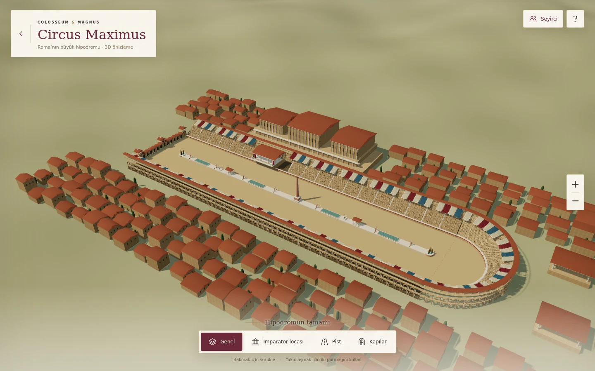

# Circus Maximus · V141

An original, navigable architectural preview for Colosseum & Magnus, based on
the Circus Maximus reference images supplied in the conversation.

Open `circus-maximus.html`. This is an architectural scene, not a playable
chariot race. It makes no authentication, game-state, currency or reward requests.
No existing game page or V140 loading/victory transition is changed.

## Included

- Long sand track with a semicircular end and twelve starting stalls.
- Twenty-eight seating rows, exterior arcades, upper colonnade and linen awnings.
- Spina with an obelisk, shrines, basins, lap-counter eggs and two sets of metae.
- Imperial pulvinar, a suggested Palatine palace complex and surrounding houses.
- 12,240 optional, instanced seated spectators.
- Overview, imperial box, track and starting-gate camera positions; mouse drag,
  touch drag, pinch, zoom buttons, wheel and keyboard controls.

The model is an artistic reconstruction, not a measured archaeological model or
an exact recreation of a single year. The source images combine different
interpretations. The builder uses approximately metre-scale geometry and a
roughly 560 × 155 m stadium footprint; these are game-scene proportions rather
than claims about the site's surveyed dimensions.

## Structure and performance

- `circus-maximus-model-v141.js`: reusable `createCircusMaximus(THREE, options)`
  builder, returning the model group, crowd group, materials and metadata.
- `circus-maximus-v141.js`: isolated viewer, texture loading and controls.
- `circus-maximus-v141.css` and `circus-maximus.html`: responsive single-screen UI.
- Uses the project's existing local Three.js r160 bundle; no new runtime CDN.
- Static geometry is merged by material; spectators use two instanced meshes.
- Rendering is demand-driven. The page does not render continuously while idle.
- Pixel ratio is capped at 1.5 for coarse-pointer devices and 1.75 otherwise.
- The opaque fullscreen loading layer is removed only after a complete frame.
  Texture failures fall back to usable materials and a visible explanation.
- Overview orientation adapts to portrait screens. Its near clipping plane is
  moved to 3 m to avoid distant ground z-fighting; close views use 0.2 m.

Browser measurement at 932 × 430, after the initial shadow pass: **19 draw calls,
418,974 triangles, 19 geometries, 5 textures**. This includes the surrounding
city, terrain and spectators. It is not an iPhone FPS benchmark. An actual
iOS/Safari device performance pass remains appropriate before adding racing.

## Validation

`tests/circus-maximus-v141.cjs` runs against a temporary local HTTP server using
Playwright/Chromium. It checks all four views, 932 × 430 / 390 × 844 / 667 × 375 /
1440 × 900 layouts, camera visibility after rotation, drag, pinch cancellation,
keyboard navigation, crowd visibility, failed-texture fallback, no game-state
requests, and no frame loop while idle. Screenshots were visually inspected.

```sh
CHROMIUM_EXECUTABLE_PATH=/path/to/chromium node tests/circus-maximus-v141.cjs
```

The test expects Playwright on Node's module search path. `LUDUS_TEST_OUTPUT`
can select an output folder. No production session is needed.



## Assets and references

All stadium geometry, surrounding architecture, crowd geometry and roof texture
are original work created for this project. No third-party stadium mesh was
downloaded, purchased or incorporated.

Existing project textures reused:

- **Sand 01**, Rob Tuytel / Poly Haven, CC0:
  <https://polyhaven.com/a/sand_01>. Local diffuse
  `assets/textures/sand_01-diff-8aecb3769d72.webp` and OpenGL normal
  `assets/textures/sand_01-nor_gl-6616ebcba18d.webp`.
- **White Sandstone Blocks 02**, Rob Tuytel / Poly Haven, CC0:
  <https://polyhaven.com/a/white_sandstone_blocks_02>. Local diffuse
  `assets/textures/white_sandstone_blocks_02-diff-291a56b4ab78.webp`.
- Three.js: existing MIT-licensed `owner-three-r160.js`.

Historical context: [Turismo Roma — Circus Maximus](https://www.turismoroma.it/en/places/circus-maximus).

Ready-made alternatives researched on 2026-10-20, not included in this scene:

| Model | Listing information | Use in V141 |
| --- | --- | --- |
| [Circus Maximus Project — salvis1](https://sketchfab.com/3d-models/circus-maximus-project-936786590811495b9f983653c27762d8) | Listed as a free download, CC Attribution; 97.7k triangles, 48.4k vertices. | Reference link only; download availability and actual asset contents were not tested. |
| [Roman Circus Maximus Hippodrome — Havolk](https://www.fab.com/listings/33980a5b-e19e-4655-9d21-bbdf76f07ed5) | FBX/PBR, 3 meshes, 3 materials, 12 textures at 2K/4K. Seller lists 12k triangles for the stadium plus 15k and 33k for the statues. | Reference link only; not purchased. |

The ready-made model listings are separate alternatives. Their licenses do not
apply to this project's original stadium geometry.
