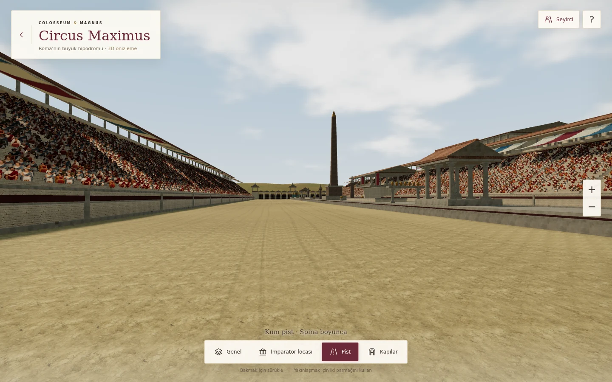
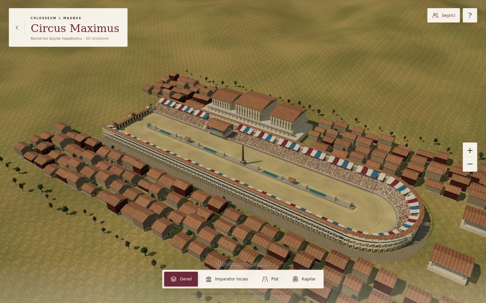

# Circus Maximus · V142 surface and lighting update

The existing, navigable 3D stadium now has photographed material maps, weathering,
more detailed spectators and a daylight environment. Open `circus-maximus.html`.
The scene remains an artistic reconstruction. It is not a measured archaeological
model, a photograph, or a playable chariot race.

## What changed

- Sand: 2K photographed colour, 1K OpenGL normal and roughness maps; matched
  stochastic sampling breaks repeated tiles without blurring the fine grain.
  Shallow wheel ruts follow both straights and the curved turning lines, with
  irregular wear, small surface height variation and dust at wall bases.
- Masonry: matched normal/roughness maps, fine plaster versus rough limestone,
  vertically streaked weathering, darker bases, bevelled arches, copings and drains.
- Roofs: photographed curved terracotta tiles with normal/roughness maps,
  projecting eaves, ridge caps and separate plaster gables.
- Architecture: paved exterior paths, varied plaster facades, window sills,
  loge floor inlays and ceiling coffers, draped stone statues and basin ripples.
- Crowd: eight generated seated figures in a transparent atlas, instanced in
  one draw call. Camera-facing cutouts are an efficient distant crowd technique;
  these are not individually animated volumetric people. The crowd toggle remains.
- Lighting: a procedural daylight/cloud sky and filtered environment lighting,
  warm direct sun, cooler shade, finer shadow bias and less screen tint.
- Environment: existing CC0 tree models instanced around the palace and houses;
  earth colour varies gradually, with the same anti-tiling treatment as the sand.

## Files

- `circus-maximus-model-v142.js`: geometry, material shaders and crowd.
- `circus-maximus-v142.js`: asset loading, lighting, controls and tree instancing.
- `circus-maximus-v142.css`: the existing white/burgundy/gold single-screen UI,
  with a lighter vignette.
- `assets/circus-v142/`: seven optimized texture files and provenance manifest.
- `tests/circus-maximus-v142.cjs`: browser checks and reproducible screenshots.

The original V141 files remain available for comparison. This change does not
modify the Ludus loading code, caravan victory flow, authentication, or rewards.
There are no third-party runtime texture/CDN requests: assets are served locally.

## Performance and recovery

Static architecture is merged by material; trees and spectators are instanced.
Rendering is demand-driven, with no animation loop while idle. Device pixel ratio
is capped at 1.5 on coarse-pointer devices and 1.75 otherwise; shadow maps use
2048 pixels for coarse pointers and 4096 otherwise. GPU buffers for the sky and
environment are rebuilt after WebGL context restoration.

The opaque fullscreen loader stays until the first complete scene is drawn.
Optional asset failures fall back to usable geometry/materials and a short hint.
No intermediate photograph or separate loading image is added to the viewport.

Final measured draw calls, triangles and layout checks are recorded in
[`circus-maximus-v142/validation.json`](circus-maximus-v142/validation.json).
The 500,000-triangle and 30-draw-call gates apply to the full, loaded scene after
its initial shadow pass. These are renderer counts, not a physical-iPhone FPS
benchmark. Actual iOS/Safari device performance has not been measured here.

## Validation

```sh
CHROMIUM_EXECUTABLE_PATH=/path/to/chromium node tests/circus-maximus-v142.cjs
```

Requires Playwright on Node's module search path. The test starts its own local
HTTP server. It checks four viewpoints; 932×430, 390×844, 667×375 and 1440×900
layouts; actual PBR/atlas loading; drag, zoom buttons, pinch cancellation and
keyboard controls; single-screen bounds; context loss/restoration; unavailable
textures; idle rendering; console errors; and absence of auth/game-state requests.
Screenshots from the actual renderer were reviewed before release.





## Assets and provenance

All architecture and surface-wear shaders are original project code. No stadium
mesh was purchased or downloaded. Download URLs, derived file hashes and sizes
are recorded in `assets/circus-v142/manifest.json`.

New optimized copies of existing CC0 Poly Haven material families:

- [Sand 01](https://polyhaven.com/a/sand_01), Rob Tuytel, CC0. Colour was reduced
  from 4K to 2K; OpenGL normal to 1K; roughness to 512 pixels.
- [Roof 09](https://polyhaven.com/a/roof_09), Rob Tuytel, CC0. Colour, OpenGL
  normal and roughness were reduced from 4K to 1K. WebP quality 88 for colour
  and roughness, 95 for normals. Normal/roughness textures are sampled linearly;
  colour textures use sRGB.

Existing project assets reused:

- [White Sandstone Blocks 02](https://polyhaven.com/a/white_sandstone_blocks_02),
  [White Plaster 02](https://polyhaven.com/a/white_plaster_02), and
  [Wooden Gate](https://polyhaven.com/a/wooden_gate), Poly Haven, CC0.
  Existing attribution is also recorded in `asset-credits-v21.txt`.
- `assets/caravan-field-v125/oak-a.glb` and `pine.glb`, Polyy.AI, CC0;
  see `assets/caravan-field-v125/LICENSE-Trees.txt`.
- The existing Three.js r160 bundle, MIT.

### Generated spectator atlas

`assets/circus-v142/spectators.webp` was generated specifically for this scene
using Imagegen in **generation** mode, with transparent background and no
reference images. The 1254×1254 RGBA output was resampled to 1280×1280 and encoded
as WebP (quality 90, alpha quality 100) for consistent 320×640 atlas cells.
This is synthetic historical costume imagery, not photographs of real spectators.
The complete generation prompt follows:

```text
Use case: historical-scene.
Asset type: a production-ready transparent RGBA sprite atlas for a 3D Roman circus spectator crowd, NOT an illustration of the stadium.
Create one square 2048 by 2048 image, arranged as a precise 4-column by 2-row grid of EIGHT separate full-body SEATED adult spectators, one person centered entirely within each equal cell. All eight figures must have identical apparent human scale, with their feet close to the bottom of their cell, and generous transparent padding left and right. No figure overlaps another cell.
People are ordinary diverse adult citizens of ancient Rome (men and women, Mediterranean and varied complexions). Historically inspired simple tunics and draped cloaks, linen and wool in dusty ivory, muted brick red, faded slate blue, olive, ochre. Natural detailed folds and weave, realistic faces, hair, hands and leather sandals. Everyone is SEATED upright as if on an invisible stone bench, knees bent, feet down, hands resting on lap, some slightly leaning or calmly talking. The bench is entirely invisible and transparent. No chairs, no ground, no props, no weapons, no armor, no lettering.
Camera: full body seated figures photographed straight on, slightly from above (about 10 degrees), all facing camera, orthographic-like long-lens capture. This is a consistent cutout atlas, not a collage of different photos. Subtle diffuse daylight, neutral illumination with very soft natural shading on clothing. No dramatic directional shadows baked in.
Style: photorealistic photographed costumed human extras. High quality physically plausible anatomy and fabric. Not painted, not cartoon, not toy figurines, not 3D low-poly.
BACKGROUND: genuine transparent alpha everywhere outside the people, including transparent spaces under knees, between legs and around arms. No contact shadows. No grid lines or frame.
```
