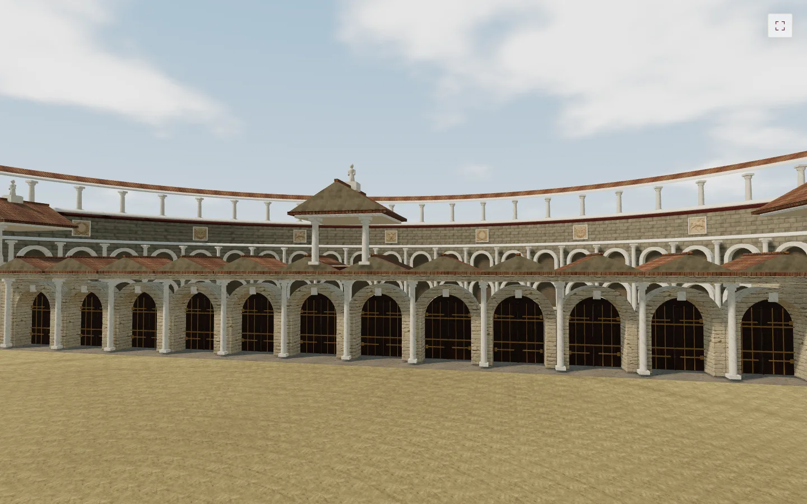
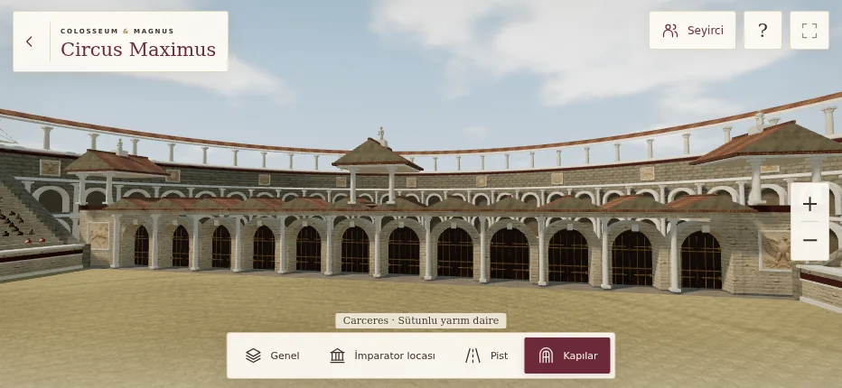
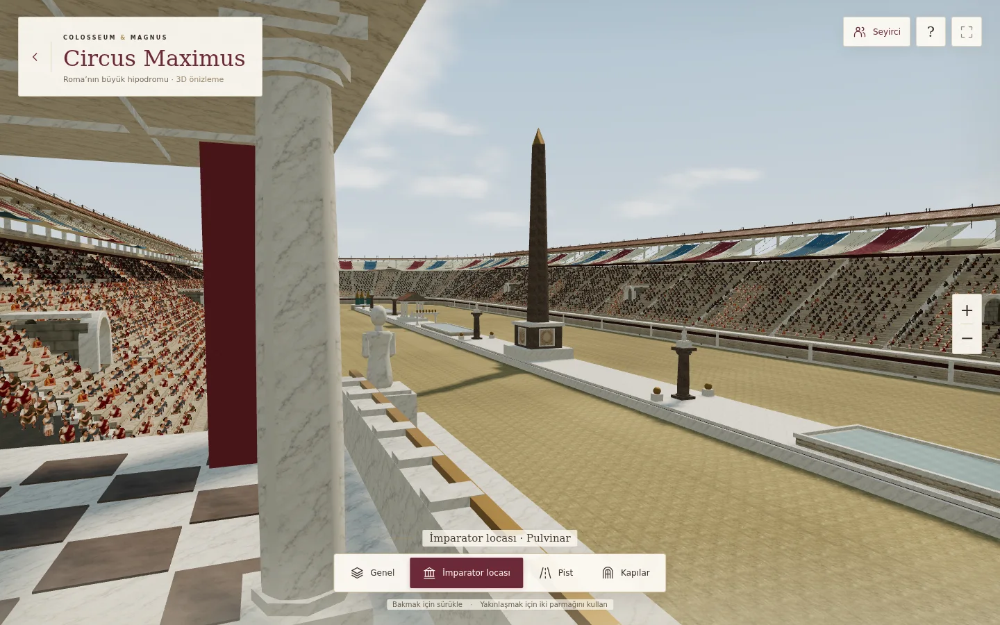
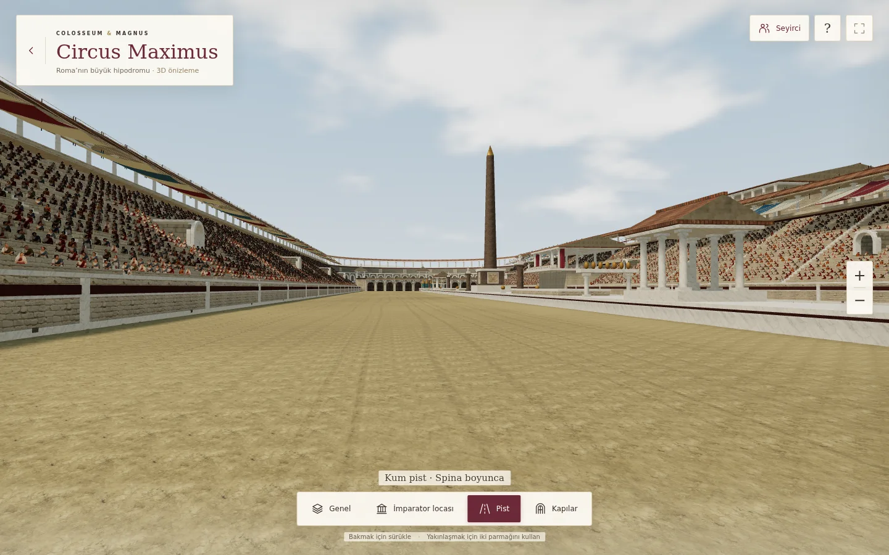
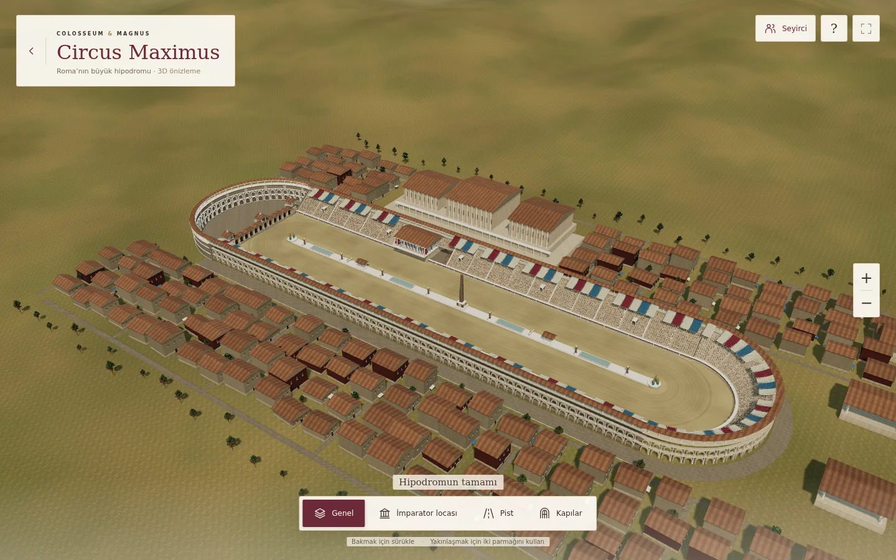

# Circus Maximus · V143

Kapıların arkasına, iki tribünle birleşen sütunlu bir yarım daire duvar eklendi.
Sahne gerçek 3D geometriyle gezilir; yeni kabartma atlası bu geometri üzerindeki
yüzey ayrıntısıdır. Açılış dosyası: `circus-maximus.html`.

Yeni duvarın merkez çizgisi 76 m yarıçaplıdır. Gövde 21 m, sütunlu üst galeri ve
çatı dahil yükseklik 28,4 m'dir; çatı mevcut uzun tribünlerle aynı hizadadır.
Duvar iki uçta bağlantı ayaklarıyla kapanır. Tribünlerin kapı tarafındaki yan
duvarları basamak eğimini izler.

## Düzeltilen 15 görsel nokta

| # | Önceki sorun | V143 değişikliği |
|---|---|---|
| 1 | Başlangıç kapılarının arkasında boş ufuk ve kopuk yapı uçları | Tam yüksekliğe ulaşan yarım daire duvar, iki kat kemerli niş, üst sütunlu galeri ve birleşen çatı |
| 2 | Kapı açıklıklarında basit dikdörtgen kanatlar ve az ayrıntı | Kemer biçimli ahşap kapılar, menteşeler, metal kuşaklar ve kilit taşları |
| 3 | Kapı kuleleri ve büyük arka duvarda boş yüzeyler | Defne, kartal, at ve akantus motifli dört yeni taş kabartma; gerçek kalınlıklı çerçeveler |
| 4 | Büyük sütunlarda düz, tekdüze gövde | Hafif şişkinlik, ince yivler, kaide ve başlık bilezikleri |
| 5 | Duvar taşlarında küçük ve tekrarlı doku ölçeği | Daha büyük taş ölçeği; yeni duvarda şaşırtmalı blok derzleri ve bloklar arası ton farkları |
| 6 | Mermerde kirli sıva rengi ve fazla pürüz | Sıva renk haritası yeni, fotoğraf görünümünde mermer dokusuyla değiştirildi; ince damarlar ve daha düşük yüzey pürüzü |
| 7 | Havada duran, düz görünen tenteler | Direkler ve gergi halatları; sarkma, kıvrım, ince dokuma ve solma |
| 8 | Enine yayılmış ve oturma yüksekliği yanlış seyirciler | Görsel oranı ve kalça yüksekliği düzeltildi; gövdeler dik tutuldu, öndeki sıralara temas gölgesi eklendi |
| 9 | Girişsiz, kesintisiz tribün basamakları | Basamaklarda gerçek boşluklarla 10 kemerli giriş; yan duvar, tavan ve geri çekilmiş iç yüzey |
| 10 | Fazla düzenli tekerlek izleri ve temiz başlangıç alanı | İz genişliği ve aralığında değişim; kapı önünde düzensiz kullanım/aşınma ayrıntısı |
| 11 | Boyalı, opak görünen havuz yüzeyi | İnce saydam su yüzeyi, gökyüzü yansıması, hafif dalga normalleri ve koyu su çizgisi |
| 12 | Tek renkli dikilitaş ve sade kaide | Granit benekleri, sığ dekoratif işaretler ve kaidede çerçeveli taş paneller |
| 13 | Tekrarlanan çevre evleri ve belirsiz yollar | Küçük yön farklılıkları, dükkân tenteleri, ahşap destekler ve taş döşeli sokaklar |
| 14 | Kapı cephesindeki ters ışık ve yaygın gölge alanı | Ön cepheye yönlenen güneş, kapı görünümüne odaklı gölge hacmi, yakın planda hafif atmosfer |
| 15 | Mobil ekranda büyük kontroller ve görüşü kapatan kamera açısı | Daha küçük yatay ekran arayüzü, dönüş işaretlerinin dışına alınan kapı kamerası, çerçeve düğmesi / H ile arayüz gizleme |

## Gerçek render görüntüleri

Aşağıdakiler çalışan WebGL sahnesinden alınmıştır.











## Doğrulama

```sh
CHROMIUM_EXECUTABLE_PATH=/path/to/chromium node tests/circus-maximus-v143.cjs
```

Node modül yolunda Playwright gerekir. Test kendi HTTP sunucusunu açar.
Sonuçlar: [validation.json](circus-maximus-v143/validation.json).

- Dört kamera; 932×430, 390×844, 667×375 ve 1440×900 ekran sınırları.
- Arka duvar boyunca 59 ışın testi, iki uç bağlantısı ve mevcut tribünle çatı yüksekliği karşılaştırması.
- Kapı kamerasının yakın dönüş işaretleri tarafından kapatılmaması.
- Gerçek kabartma/PBR/seyirci görsellerinin yüklenmesi.
- Sürükleme, yakınlaştırma düğmeleri, iki parmak ve dokunma iptali, klavye ve arayüz gizleme.
- Tam ekran yükleyici, WebGL bağlam kaybından kurtarma, yüklenemeyen görseller için yedek görünüm.
- Boştayken sürekli çizim olmaması, konsol hatası ve oyun hesabı/veri isteği bulunmaması.
- Tam yüklenmiş sahnede 30 çizim çağrısı ve 500.000 üçgen sınırı.

Uzak halatların kapakları ve görünmeyecek seyirci temas gölgeleri çizilmez.
Ağaçlar ile seyirciler örneklenerek, statik mimari malzemeye göre birleştirilerek
çizilir. DPR ve gölge haritası sınırları V142'den korunur. Sayılar yazılımsal
Chromium/WebGL ölçümüdür; fiziksel iPhone/Safari FPS testi değildir.

Bu hâlâ yorumlu bir 3D canlandırmadır. Fotoğraf veya ölçülmüş arkeolojik model
iddiası taşımaz. Seyirciler uzaktan kullanım için görsel düzlemlerdir; ayrı ayrı
animasyonlu, hacimli insan modelleri değildir. Yeni duvar kullanıcı isteğine göre
tasarlanmıştır. Dekoratif dikilitaş işaretleri okunabilir tarihî bir yazıt değildir.

## Dosyalar ve kaynaklar

- `circus-maximus-model-v143.js`: mimari, malzeme ayrıntıları ve seyirciler.
- `circus-maximus-v143.js`: yükleme, ışık, gölge ve kontroller.
- `circus-maximus-v143.css`: tek ekran arayüz ve gizleme modu.
- `assets/circus-v143/stone-reliefs.webp`: yeni taş kabartma atlası.
- `assets/circus-v143/honed-marble.webp`: yeni açık mermer renk dokusu.
- `assets/circus-v143/manifest.json`: boyut, içerik özeti ve kaynak kaydı.
- `tests/circus-maximus-v143.cjs`: tekrarlanabilir kontroller.

V142 malzemeleri, seyirci atlası ve mevcut CC0 ağaçları yeniden kullanılır;
önceki kaynaklar [V142 kaydında](circus-maximus-v142.md) bulunur.
Yeni stadyum modeli indirilmedi; mimari proje kodudur. Bu sürüm Ludus'un yükleme,
kervan sonucu, kimlik doğrulama veya ödül kodunu değiştirmez.

### Yeni taş kabartma atlası

**Yöntem:** Imagegen, generation modu, yeni görsel, referans görselsiz, opak arka plan.
Dört kare panel (2 sütun × 2 satır), 1280×1280 WebP, kalite 90.
Yapay zekâyla üretilmiş taş yüzeyidir; gerçek bir eserin taraması değildir.
Sahnedeki çerçeve ve sütunların derinliği gerçek geometridir; panelin kabartma
derinliği renk görselinde temsil edilir.

**Çıktı:** `assets/circus-v143/stone-reliefs.webp`

Tam üretim istemi:

```text
Use case: historical-scene.
Asset type: a single production texture atlas for decorative stone relief panels on an interactive 3D Roman circus facade. This is a MATERIAL ASSET, not a picture of the stadium.
Composition: one square image, exactly four equal SQUARE panels in a clean 2 by 2 grid. Each quadrant is filled edge to edge with a flat rectangular slab of pale warm ivory Roman limestone. All four slabs have the same stone colour, size and front-facing orthographic perspective. Leave a narrow plain-stone perimeter in each quadrant. No frames or grid lines between panels.
Top left panel: deeply carved classical Roman laurel wreath with an elegant tied ribbon, a blank stone center.
Top right panel: deeply carved Roman eagle with wings spread symmetrically, resting above a small laurel branch. No letters or symbols in the center.
Bottom left panel: shallow classical stone relief of a galloping horse seen from the side, beautifully sculpted anatomical detail, no rider.
Bottom right panel: elegant Roman acanthus leaves and hanging garland carved into the stone, balanced symmetrical composition.
Style: extremely photorealistic close-up archaeological stone photography, fine mineral pores, tiny chips on edges of carving, restrained weathering and settled dust in crevices. The reliefs are integral carvings in the slab, NOT separately attached objects.
Lighting: broad diffuse neutral daylight, soft cavity shading to reveal relief, no strong diagonal cast shadow, no vignetting, no color grading. Good for a diffuse texture on 3D geometry.
Constraints: zero perspective distortion, no exterior scene, no text, no labels, no watermark, no people, no bright white blank backgrounds, no brown or green stains. No transparent background. Ivory stone fills every pixel.
```

### Yeni mermer dokusu

**Yöntem:** Imagegen, generation modu, referans görselsiz, opak arka plan.
**Çıktı:** `assets/circus-v143/honed-marble.webp`, 1024×1024, WebP kalite 90.
Fotoğraf görünümünde üretilmiş bir renk dokusudur; gerçek taş taraması değildir.
Mevcut ince yüzey normal haritası düşük kuvvetle yeniden kullanılır.

Tam üretim istemi:

```text
Use case: historical-scene. Asset type: one square, tileable diffuse/albedo texture for the marble columns and architectural trim in a real-time 3D Roman circus. Material: honed ivory-white Carrara-like marble, gentle pale grey and warm taupe branching veins, naturally irregular soft mineral clouding, very fine visible crystalline grains and tiny pores. It should look like close-up calibrated architectural material photography of a 2 metre square area, not a render. Keep the base light ivory, with enough subdued medium-light grey variation for realistic architectural columns. Most of the image is white mineral, with a few slender veins running irregularly diagonally. Lighting: completely diffuse, uniform and shadowless, no shading gradient, no highlights or reflections baked in. Composition: flat front-on orthographic view; marble fills every pixel, no objects, no slab edges, no seams or grout, no border, no text, no labels. Seamlessly tileable on all four edges; fine details at consistent scale. No dark black veins, no dirty brown concrete, no painted brush strokes, no scratches or cracks. Opaque background. Output one square material texture.
```
