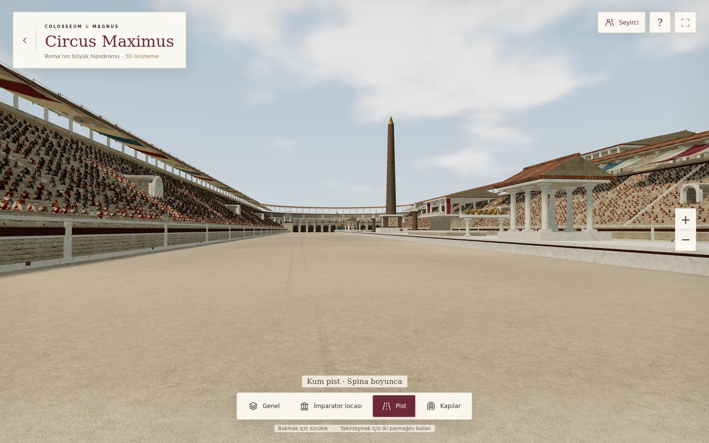
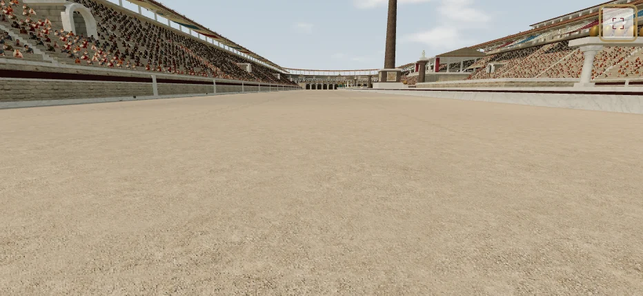
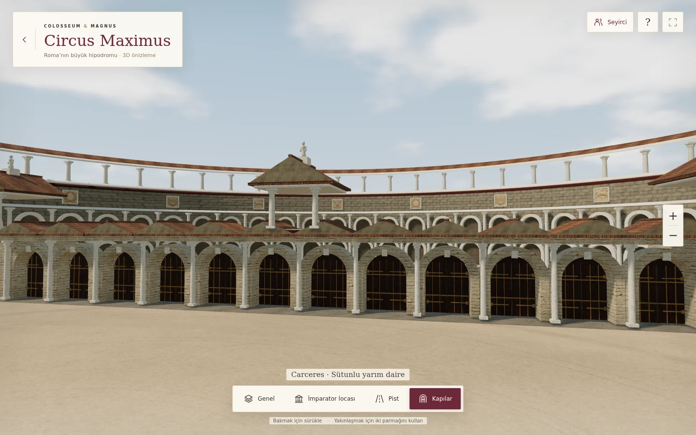
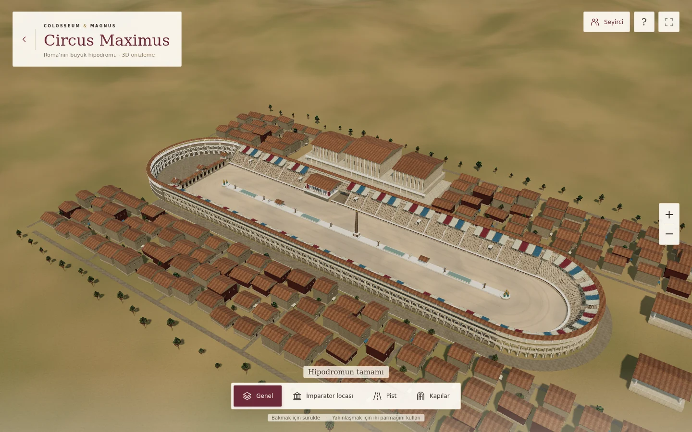

# Circus Maximus · V144
Kum tekrarını azaltan yeni yüzey ve 20 görsel yenileme. Açılış: `circus-maximus.html`.

## Yenilenen 20 nokta
1. **Kum dokusu ve tekrar:** Yeni sıkışmış kum/ince çakıl görseli; üçgen hücrelerde bağımsız yön, ölçek ve başlangıç noktasıyla üç örnek karıştırılır. Eski düzenli dalga kabartması pistten kaldırıldı.
2. **Bölgesel kum rengi:** Büyük ve orta ölçekte düzensiz sıcak–soğuk mineral tonları.
3. **Yakın kum ayrıntısı:** Yeni renk dokusundan ince yüzey yüksekliği; uzaklaştıkça süzülen tane ayrıntısı.
4. **Pist geometrisi:** Sinüs çizgileri yerine düzensiz santimetrelik yükselti; virajda da bölünmüş gerçek yüzey.
5. **Tekerlek izleri:** Eşit aralıklı çok sayıda çizgi yerine, yönü ve görünürlüğü değişen üç çift iz.
6. **Nal izleri:** Kullanılan bölgelere seyrek, konumu ve açısı farklı küçük baskılar.
7. **Sıkışmış bölgeler:** Yarış çizgisi ve başlangıç kapıları önünde düzensiz kullanım tonları.
8. **Kenar birikintileri:** Duvar dibinde değişken yükseklikte kum kabarması ve birikinti rengi.
9. **Çakıl dağılımı:** Değişken boyut, yassılık, renk ve kümelenme; taşlar yeni zemin yüksekliğine oturur.
10. **Taş blokları:** Tekdüze cephelerde blok bazında ince ton farkları.
11. **Derz derinliği:** Yeni yarım daire duvarın derzlerine ışığa tepki veren yüzey girintisi.
12. **Duvar dipleri:** Dağınık nem/mineral birikimi ve ölçülü yeşilimsi yaşlanma.
13. **Mermer:** Aynı damar deseninin tekrarını azaltan farklı yönlü ve ölçekli örnekleme.
14. **Ahşap kapılar:** Tahta bazında ton farkı, ince damar ve yer yer açılmış aşınma rengi.
15. **Bronz:** Altın renkli metal ve patinalı bronzda düzensiz oksitlenme.
16. **Tenteler:** Kenar kıvırma izi, orta dikiş ve düzensiz güneş solması.
17. **Kiremitler:** Pişirme kaynaklı kırmızı/kahverengi ton farkları ve yüzey değişimi.
18. **Havuz suyu:** Kıyıda farklı renk/saydamlık, daha düzensiz küçük dalgalar.
19. **Seyirciler:** Aynı görsellerin kalabalıkta kopya hissini azaltan sınırlı sıcak–soğuk renk ve parlaklık farkları.
20. **Çevre pencereleri:** Gerçek yan yüzeyli pencere çerçeveleri ve farklı açıklıkta ahşap kepenkler.

## Görüntüler
Aşağıdaki görüntüler çalışan WebGL sahnesinden alınır; sunum için üretilmiş stadyum görselleri değildir.






## Kontroller
`tests/circus-maximus-v144.cjs` Playwright ve Chromium ile çalışır:
```sh
CHROMIUM_EXECUTABLE_PATH=/path/to/chromium node tests/circus-maximus-v144.cjs
```
Dört kamera, dört ekran boyutu (932×430, 390×844, 667×375, 1440×900),
dokunmatik/mouse/klavye, arayüz gizleme, gerçek görsel yüklemeleri,
kum yüksekliği ve düz pist–viraj birleşimi, arka duvar bütünlüğü,
WebGL bağlam kurtarma, eksik görseller, boşta çizim ve hesap isteği izolasyonu
kontrol edilir. Sonuç: [validation.json](circus-maximus-v144/validation.json).
30 çizim çağrısı ve 500.000 üçgen sınırı korunur. Sayılar tarayıcı ölçümüdür;
fiziksel iPhone FPS ölçümü yapılmadı.

Yeni kum renk görseli 1280×1280 WebP'dir; eski pist renk görselinden küçüktür.
Tane ayrıntısı uzaklıkta süzülür. Çakıllar daha az üçgenle çizilir.
Malzemeler birleştirilmiş, seyirciler ve ağaçlar örneklenmiş olarak kalır.
Yeni shader işlemlerinin maliyeti GPU'ya göre değişebilir; üçgen sayısı tek başına
FPS garantisi değildir.

## Kaynaklar ve görsel üretimi
Mimari ve yüzey hesapları proje kodudur. Önceki kaynaklar:
[V143](circus-maximus-v143.md), [V142](circus-maximus-v142.md).

Yeni görsel **Imagegen yerleşik araç / generation** modunda, referans görselsiz ve
opak olarak üretildi. Bu, fotoğraf görünümünde sentetik bir malzeme görselidir;
gerçek bir arkeolojik zeminin taraması değildir. Doku rengiyle ilişkili yüzey
ayrıntısı shader içinde hesaplanır; eski kum normal haritası pistte kullanılmaz.

Çıktı: `assets/circus-v144/arena-sand.webp`. 1280×1280, WebP kalite 92.
Boyut ve SHA-256: `assets/circus-v144/manifest.json`.

Tam üretim istemi:
```text
Use case: historical-scene. Asset type: a square physically based albedo texture for an ancient Roman hippodrome dirt and sand racing track in a real-time 3D game. Straight-down orthographic calibrated material photograph of a 3 metre by 3 metre patch of dry compacted arena sand. Natural pale beige and warm grey mineral grains, irregular tiny tan gravel, fine crushed stone, subtle compacted worn patches and loose gritty patches, realistic irregular scale variation and very shallow random scuffs. The whole image is evenly detailed, with natural medium-frequency variation that stays visible on a 3D ground plane. Matte mineral surface. No large stones, no sand dune waves, NO regular ripple patterns, no parallel stripes, no tiles or grid, no footprints or large wheel tracks baked in, no plants or debris. Neutral overcast shadowless illumination; no vignetting, no highlights, no directional light baked in. Seamless on all four edges. Every pixel is surface, no horizon, no border, no labels, no text, no watermark. Photorealistic material photography, not a painting or smooth beige illustration. Opaque background.
```
