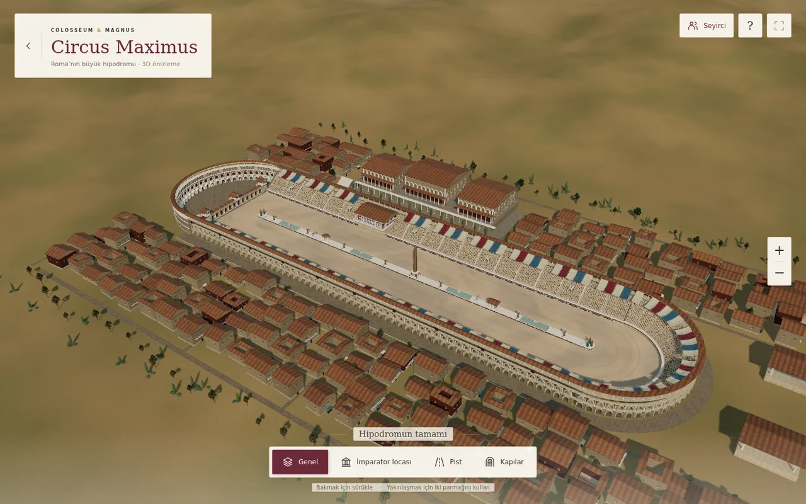
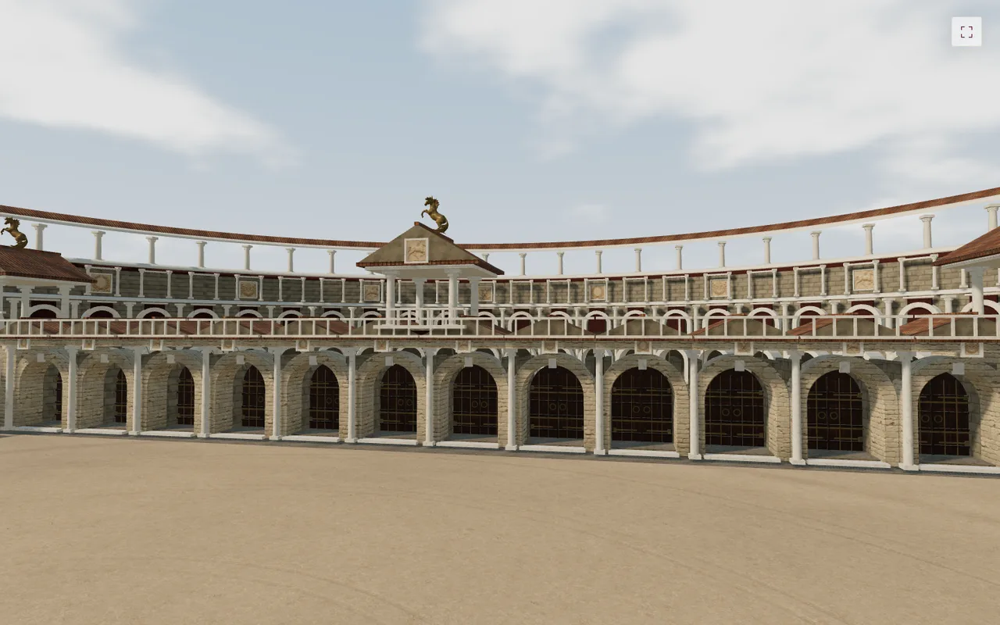
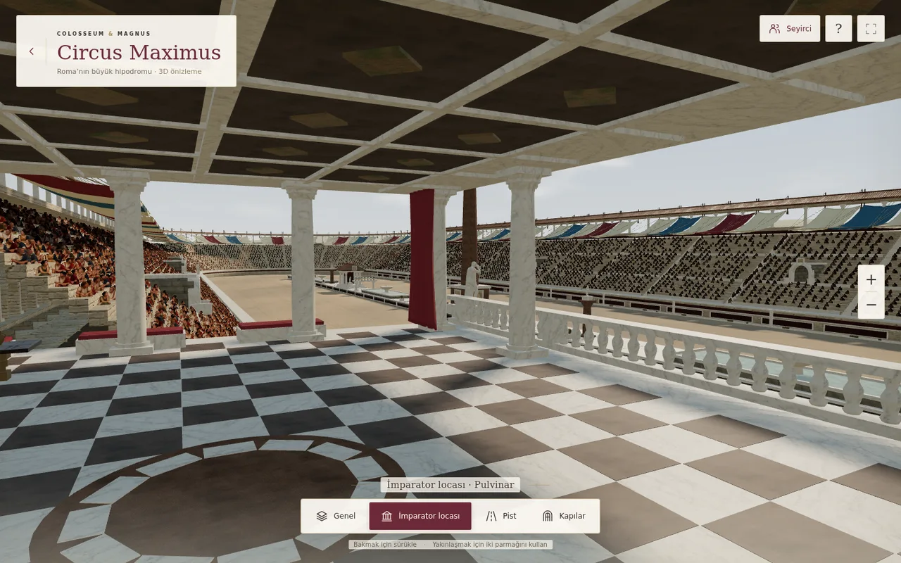
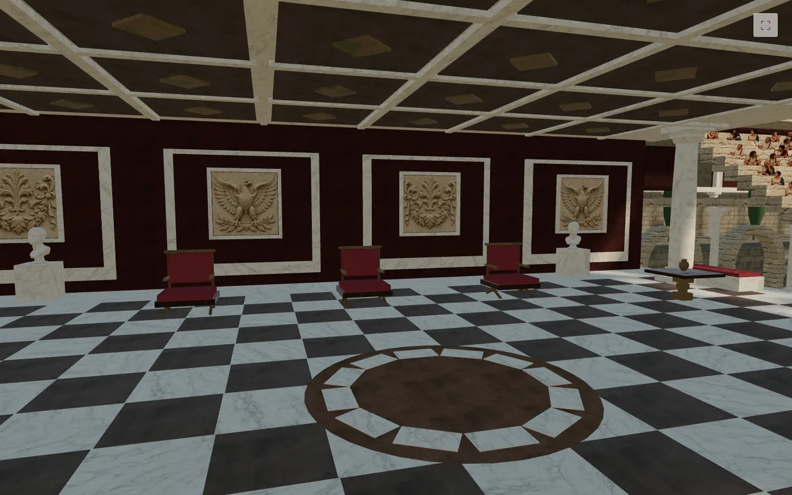
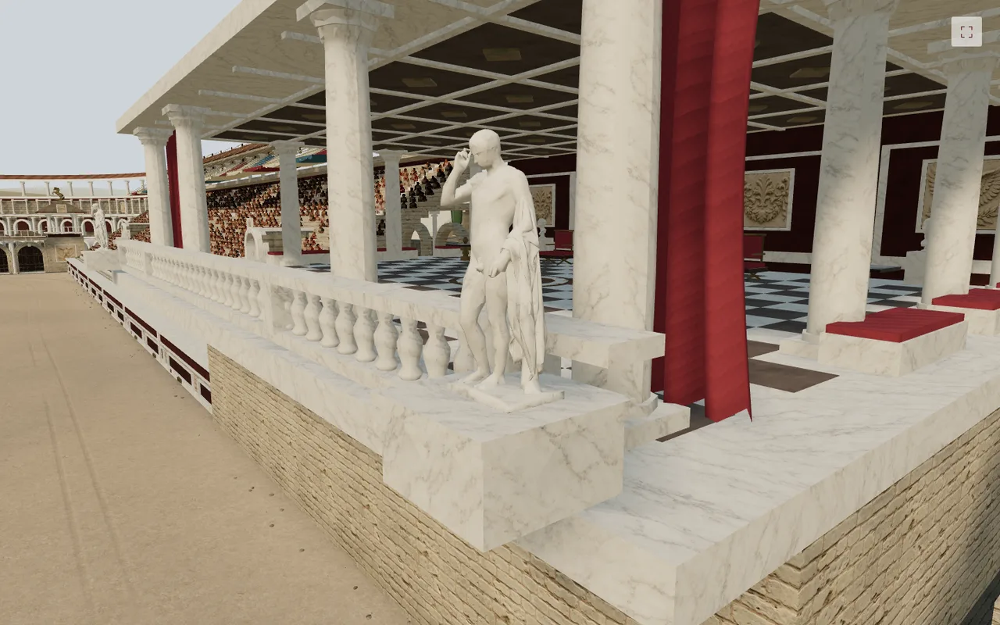
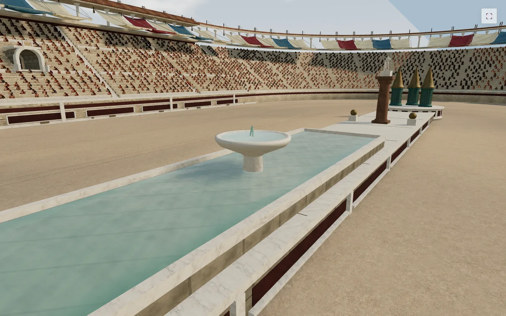
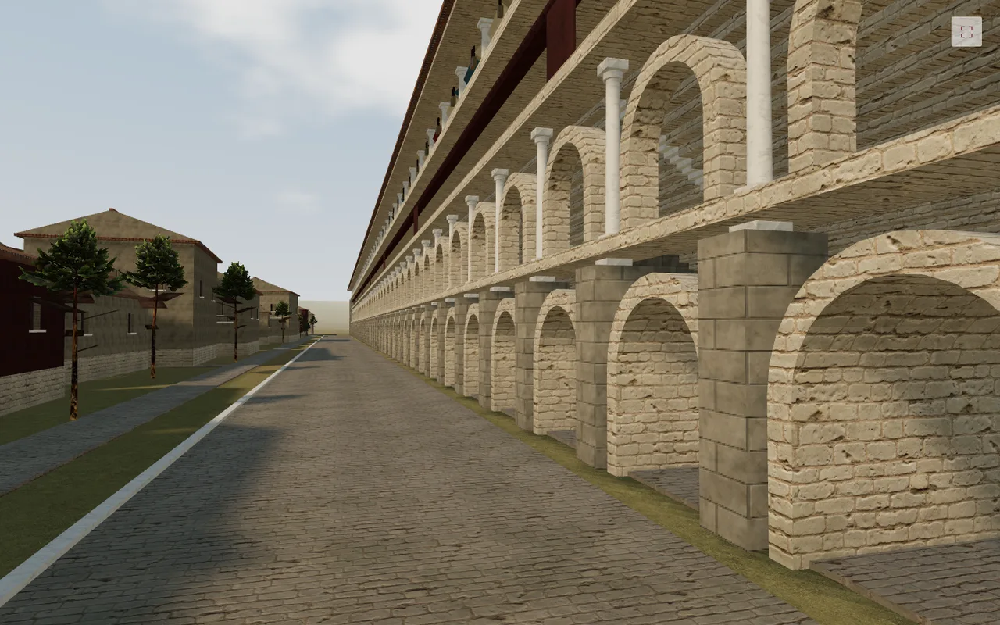
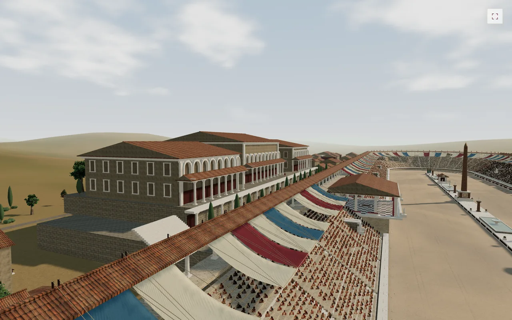

# Circus Maximus V145 — 20 ayrı alan

Bu sürümde aynı zeminin alt ayrıntıları ayrı iyileştirmeler olarak sayılmadı. Aşağıdaki her satır farklı bir yapı, nesne grubu veya sahne sistemi. V144 kum dokusu ve tekrar kırma yöntemi korundu.

| # | Alan | Önceki zayıflık | V145 değişikliği |
| --- | --- | --- | --- |
| 1 | Başlangıç kapıları / carceres | Kapılar duvara yapıştırılmış gibi duruyordu. | Geri çekilmiş kapı kanatları, yan bölme duvarları, taş eşikler, halkalı donanım, halat mekanizması ve ön teras yapıldı. |
| 2 | Kapıların arkasındaki yarım daire | Büyük duvar yüzeyi boş ve tekdüzeydi. | Üst nişler, küçük sütunlar, kırmızı girintiler ve büstlü kaideler eklendi. Yarım daire ve iki tribünle birleşimi korundu. |
| 3 | Pist çevre duvarları | Uzun taş şeritler ayırt edilmiyordu. | Mermer çerçeveli panolar, alt kuşaklar, payeler ve tahliye ızgaraları eklendi. |
| 4 | Tribün oturma alanları | Kesintisiz, aynı biçimde sıralanan basamaklar. | Oturma bölümlerini ayıran alçak korkuluklar ve aşınmış basamak kenarları yapıldı. Loca sınırındaki sıralar ve merdivenler gerçek açıklığa göre kesildi. |
| 5 | Tribün giriş tünelleri | Sığ ve parlak kemer ağızları. | Derin tonoz, iç basamaklar, yan korkuluk ve geride kalan karanlık duvar yapıldı. |
| 6 | Seyirciler | Az sayıda tekrar eden oturuş ve aynı doluluk. | 16 farklı fotoğraf dokulu seyirci, farklı oturuşlar, bölgesel doluluk, konum ve boy çeşitliliği. Yeni atlasın kare hücreleri doğru insan oranıyla kullanılıyor. |
| 7 | Tribün tenteleri | İnce, düz ve desteksiz kumaşlar. | Daha belirgin sarkma, dalgalı etek, kalın direkler, metal ayaklar ve gergi halatları yapıldı. |
| 8 | İmparator locası | Boş oda, blok perdeler, katı korkuluk. | Kıvrımlı perdeler, mermer korkuluk, döşemeye gömülü desen, uyumlu kaset tavan, oturma takımı, masalar ve duvar panoları eklendi. Kamera odanın içini gösterecek şekilde taşındı. |
| 9 | Heykeller | Küre başlı, silindir gövdeli figürler. | Gerçek 3B heykel geometrisi, ayrıntılı büstler ve kapı kulelerinde bronz at heykelleri kullanıldı. Kaynak modeller mobil sahne için sadeleştirildi. |
| 10 | Orta ayırıcı / spina | Tek parça uzun beyaz levha. | Taş kaide, girintili renkli panolar, dikey bitişler ve yürüyüş yüzeyinde birleşimler yapıldı. |
| 11 | Dönüş kuleleri / metae | Köşeli basit koniler. | Yuvarlatılmış metal profiller, gövde yivleri, kalıplı halkalar ve çok katlı dairesel taş taban yapıldı. Metal yüzeye oksit ve ince pürüz eklendi. |
| 12 | Dikilitaş | Karanlık ve düz gövde. | Pembe granit görünümü, belirgin dekoratif oyma şeritleri, kademeli temel ve köşe detayları eklendi. İşaretler tarihî metin olarak sunulmuyor. |
| 13 | Tur sayaçları | İki yerde de aynı yumurta biçimleri. | Bir sayaçta yedi yumurta, diğerinde eğri gövdeli ve yüzgeçli yedi bronz yunus; ayrı kaideler ve uç direkler yapıldı. |
| 14 | Su havuzları | Düz su dikdörtgenleri. | Taş çanaklı çeşmeler, derindeki döşeme, su yüzeyinde radyal normal dalgaları ve ince su geometrisi eklendi. Su görüntüsü statiktir. |
| 15 | Orta hattaki tapınaklar | Birbirinin aynısı iki basit çatı. | Bir yuvarlak sütunlu yapı, bir basamaklı dikdörtgen tapınak; iç duvar, alınlık ve heykel düzeni yapıldı. |
| 16 | Dış kemerli galeriler | İç derinliği olmayan kemer çerçeveleri. | Derin tonozlar, döşeme, taşıyıcı ayak ve gerideki duvar eklendi. Eski temel bloğunun kemer ağızlarını kapatması düzeltildi. |
| 17 | Palatin sarayı | Büyük, düz kutular. | Katmanlı galeriler, üst kemerler, yan cephe pencereleri, kornişler, geniş merdiven ve teras bitkileri eklendi. |
| 18 | Çevre mahalle | Tek tip evler ve boş yan cepheler. | Avlulu evler, balkonlu yapılar, birden fazla cephede pencereler, dükkân tezgâhları ve amforalar yapıldı. |
| 19 | Peyzaj | Sıraya dizilmiş aynı ağaçlar. | Serviler, farklı yükseklikteki teras ağaçları ve düzensiz çalı kümeleri eklendi. Teras bitkileri doğru kotta duruyor. |
| 20 | Gün ışığı ve atmosfer | Düz aydınlatma ve zayıf hacim hissi. | Güneş açısı, sıcak ışık / serin gölge dengesi, çevre ışığı, gökyüzü ve pozlama birlikte ayarlandı. Gölge haritası kamera konumuna göre hazırlanıyor. |

## Doğrulama

`tests/circus-maximus-v145.cjs`, gerçek Three.js/WebGL sayfasını Chromium'da açar. Dört kamera, 932×430 / 390×844 / 667×375 / 1440×900 ekranları, sürükleme, yakınlaştırma, dokunma iptali, seyirci düğmesi, klavye ve arayüz gizleme kontrol edilir.

Yeni kontroller: üç GLB'nin yüklenmesi, 16 kişilik atlasın doğru boyutu, eksik varlık uyarısının olmaması, locada tribün çakışması bulunmaması ve dış galerinin yürüme yüksekliğinde açık olması. Yarım daire duvarı 59 ışın ve iki birleşim noktasında denetlenir; kum pistin dönüş birleşimi de ölçülür.

WebGL bağlamının kaybolup geri gelmesi, bütün isteğe bağlı varlıkların yüklenemediği durum ve beklerken çizim döngüsünün durması test edilir. Önizleme oyun verisine veya kimlik doğrulamaya istek göndermez.

Tam sahne: 31 çizim çağrısı, 716.710 üçgen, 12.546 seyirci. Test sınırı: 32 çağrı / 720.000 üçgen. Uzak süslemelerin geometri ayrıntısı azaltıldı; heykeller 3.600–4.800 üçgen aralığında tutuldu. Bunlar fiziksel iPhone FPS ölçümü değildir; Safari ve cihaz sıcaklığı için gerçek cihaz testi yapılmadı.

## Sahnenin gerçek ekran görüntüleri

Bunlar uygulamadan alınan görüntülerdir; tanıtım için üretilmiş render değildir.

## Varlıklar ve sınırlar

[Kaynaklar, lisanslar, kaydedilen varlık yolları ve yeni seyirci görselinin tam üretim istemi](../assets/circus-v145/SOURCES.md).

Sahne yorumlu bir yeniden canlandırmadır; belirli bir tarihî evrenin arkeolojik ölçümü değildir. Seyirciler fotoğraf dokulu düzlemlerdir; hareketli 3B insan veya yarış oynanışı eklenmedi. V145 mimari ayrıntıyı artırır, tam fotoğraf gerçekçiliği iddiası taşımaz.
