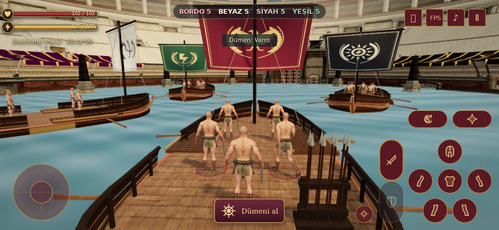
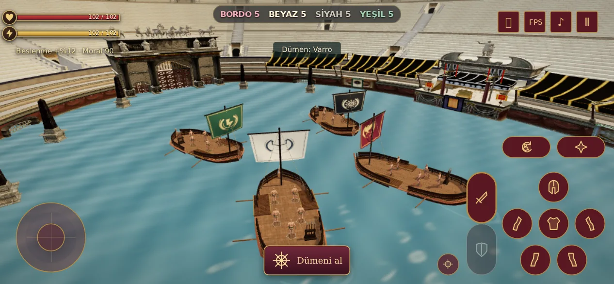
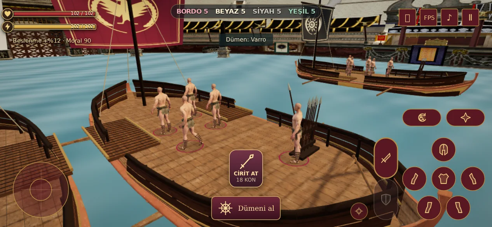

# Deniz Savaşı V100

Herculaneum modelinin geniş güvertesine kıvrımlı, yükseltilmiş ahşap bordalar, kuşaklar ve küpeşte eklendi. Küçük kıç bayrakları kaldırıldı. Katlanmış yelkenin yerine açık, bombeli bez yelken ve yüksek direk kullanılıyor; yelken altı dövüş alanını açık bırakıyor.

| Takım | Yelken | Amblem |
| --- | --- | --- |
| Oyuncu | Bordo | Altın kartal ve defne |
| 2 | Kırık beyaz | Lacivert üç dişli mızrak |
| 3 | Siyah | Fildişi güneş |
| 4 | Koyu yeşil | Altın şimşek ve defne |

Takım göstergeleri ve ayak halkaları yelkenlerle uyumludur. Normal arena renkleri korunur. Aynı cihazdan devam bağlantısı da deniz renklerini tanır.





## Kamera ve yaklaşma

Oyuncu kamerasının yatay takip mesafesi 6,5 m’den 5,1 m’ye; dümen kamerası 13 m’den 8,4 m’ye indirildi. Bakış noktası biraz ileri ve yukarı alındı: oyuncu yakın kalırken karşı gemilerin açık yelkenleri görülebilir. Ekranı sürükleme devam eder.

Dört gövde farklı konum ve açılarda, çakışmadan başlar. Yaklaşma hedefleri boyuna kaydırılır ve karşılıklı pruvalar kullanılır; dört gemi aynı çizgiye park etmez. Güvenli köprü açmak için son yaklaşmada yan bordalar hizalanır. Karşı geminin bordasında köprünün ulaştığı noktaya göre bir geçiş açıklığı oluşur; gölge de aynı açıklığı izler. Döndürülmüş güverte ve köprü sınırlarındaki kayan nokta toleransı düzeltildi.

## Cirit

Her güvertede, köprü geçişinden uzakta kıç tarafında **8 ciritli bir silahlık** bulunur. Köprü ve atlayış hedefi silahlığın üstüne denk gelirse geçiş önerilmez. Yaklaşınca **CİRİT AL** görünür; elde bir cirit varken **CİRİT AT** olur. Bilgisayarda **F** alma, **Q** atma; cirit taşırken saldırı tuşu da atar. Kilitli hedef menzildeyse önceliklidir, aksi halde yakındaki düşman hedeflenir.

Atış 18 kondisyon harcar ve en fazla 22 m gider. Hazırlık, elde görünen cirit, uçuş, isabet, kalkan savunması, havadaki hedef ve duraklatma simülasyona bağlıdır. Cirit adedi görsel silahlıkta da azalır. Oyuncunun ana silahı ve kalkanı envanterden çıkarılmaz; atıştan sonra tekrar görünür. Ciritler bu savaşın sarf malzemesidir; yeni eşya veya ganimet kaydı üretmez. Botlar mevcut dövüş ve köprü davranışını sürdürür.



## Doğrulama ve yük

- **66 otomatik kontrol geçti:** deniz savaşı, kaynak model bütçesi/lisansı, atlayış, cirit ve dövüş/script regresyonları.
- Gerçek sayfa Chromium’da 667×375, 844×390, 932×430, 1024×768 boyutlarında kontrol edildi. Menüden giriş, dümen/AI devri, köprü, dokunmatik/Boşluk atlayışı, uçuşta ölüm ve devam bağlantısı geçti.
- Cirit için dokunmatik/F alma, silahlık sayısı, eldeki mesh, dokunmatik/Q atma, görünür uçuş, duraklatma, karşı gemide isabet ve mevcut ekipmanın korunması doğrulandı. Cirit ve atlama düğmeleri mevcut kontrollerle çakışmıyor; JavaScript hatası yok.
- Herculaneum GLB değişmedi: **1,46 MB ve tek indirme**. Dört gemi geometri/dokuları paylaşır. Yeni bez dokuları 512×512 boyutunda bir kez üretilir; cirit silahlıkları instanced mesh kullanır.
- Bordalar, açık yelkenler, ciritler ve köprüler dahil **dört görünür gemi toplam 40.104 üçgen**. Güvertedeki tüm yürünebilir örnek noktalarının altında çizilen yüzey bulundu.
- [Ham tarayıcı raporu](browser.json). Yazılımsal GPU testi fiziksel telefon FPS ölçümü değildir. Yakın ve daha yatay kamera daha fazla arena ve rakip gösterdiğinden önceki sürümün farklı kadrajındaki toplam çizim sayıları doğrudan karşılaştırılamaz.

```sh
node --test tests/naval-v97.test.cjs tests/naval-boat-v98.test.cjs tests/naval-jump-v99.test.cjs tests/naval-javelin-v100.test.cjs tests/combat-feel-v23.test.cjs
LUDUS_TEST_OUTPUT=/tmp/naval-v100 node tests/naval-browser-v97.cjs
```

Kaynak model ve lisans: [V98](../naval-v98/README.md). Yeni ek parçalar `naval-outfit-v100.js` içinde paylaşılan geometri olarak üretilir; modelin orijinal dosyası korunur.
