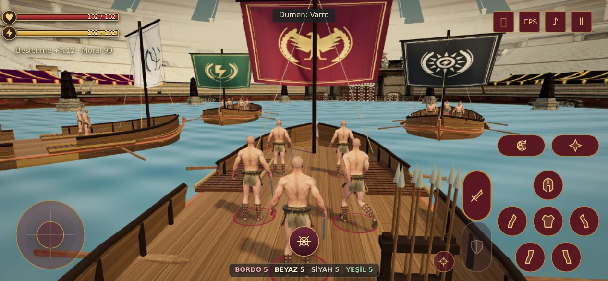
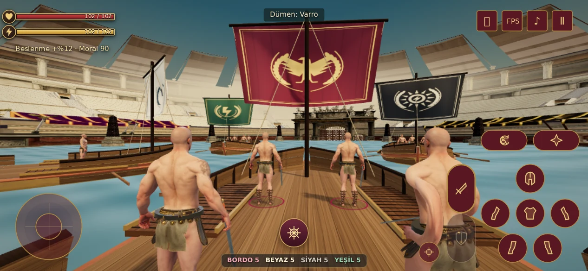
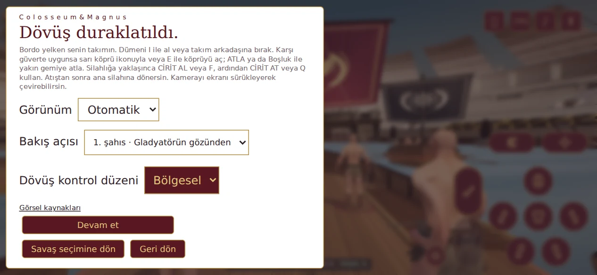

# Deniz Savaşı V101

Dümen düğmesi yalnızca ikondan oluşur; bölgesel kontrollerdeki kafa ikonu ile aynı ölçüyü kullanır (844×390 ekranda 42 px). Al/bırak anlamı erişilebilir etikette ve düğmenin aktif renginde korunur. Kondisyon uyarısı 9 px, takım sayacı ekranın altındadır. Köprü açıklaması ikonun üstüne alınır; atlayış, cirit ve dümen alanı açık kalır.

## Kamera

Üçüncü şahıs yatay takip mesafesi 5,1 m’den 4,25 m’ye, dümen takibi 8,4 m’den 7 m’ye indirildi. Duraklat → Bakış açısı altında iki seçenek vardır. Seçim aynı cihazda saklanır.

Birinci şahıs kamera animasyonlu baş kemiğinin göz hizasını izler. Sürükleyerek yatay/dikey bakış, dümen, atlayış ve normal dövüş kontrolleri devam eder. Oyuncunun başı renk geçişinde maskelenir; miğfer kameradan gizlenir; gövde, kollar, ekipman, diğer gladyatörler ve gövde/baş gölgesi korunur. Bu işlem tek oyuncunun geometrisinde bir kez hazırlanır. Ölünce üçüncü şahıs izleme kamerasına dönülür.





## Alan ve gemiler

Oynanabilir su alanı V100’ün **2 katıdır**: yarıçap 34,2 m’den 48,37 m’ye çıkar. Kolezyumun yatay ölçeği, su yüzeyi, gemi sınırları, AI yaklaşma sınırı ve kamera çarpışma sınırı birlikte güncellenir. İlk karşılaşmayı uzaklaştırmamak için gemilerin başlangıç konumları korunur.

Herculaneum kaynak modeli korunur. Güverte ve bordalarda paylaşılan damarlı, budaklı ve ek yerleri belirgin ahşap dokusu kullanılır. Borda tahtalarının iç yüzeyi ve kalınlığı vardır. Açık yelkenlerde yıpranmış kumaş, dikiş, daha dolgun kıvrım ve hafif rüzgâr hareketi bulunur; dört takımın renk ve amblemleri korunur.

GLB hâlâ 1,46 MB ve bir kez indirilir. Dört geminin ek parçalar, köprüler, silahlıklar ve ciritler dahil toplamı **43.144 üçgen**; dokular/geometriler paylaşılır. Yeni 1024×256 ahşap dokusu bir kez üretilir. Yelken hareketi GPU’da tek zaman değeriyle işlenir.

## Doğrulama

- 67 otomatik kontrol geçti: simülasyon, yeni alanın kullanılabilirliği, model bütçesi/lisansı, köprü, atlayış, cirit, dövüş ve gömülü scriptler.
- Gerçek tarayıcıda menüden giriş, AI/dümen devri, iki yönde dümen, köprü açma ve karşıya geçiş, dokunmatik/Boşluk atlayışı, cirit alma/fırlatma/isabet ve devam bağlantısı geçti.
- Kamera seçimi, yeniden açılışta tercih, göz yüksekliği, miğfer maskesi, aşağı bakış, dümen, havada yükselme, duraklatma ve ölümde izleme kamerası doğrulandı.
- 667×375, 844×390, 932×430 ve 1024×768’de dümen, atlayış, cirit, köprü ve takım sayacının diğer sabit kontrollerle çakışmadığı kontrol edildi. JavaScript/WebGL hatası yok.
- [Tarayıcı ölçümleri ve son kamera/yerleşim kontrolleri](browser.json). Yazılımsal GPU kullanıldı; fiziksel telefon FPS ölçümü değildir.

```sh
node --test tests/naval-v97.test.cjs tests/naval-boat-v98.test.cjs tests/naval-jump-v99.test.cjs tests/naval-javelin-v100.test.cjs tests/combat-feel-v23.test.cjs
LUDUS_TEST_OUTPUT=/tmp/naval-v101 node tests/naval-browser-v97.cjs
```

Kaynak model ve lisans: [V98](../naval-v98/README.md).
