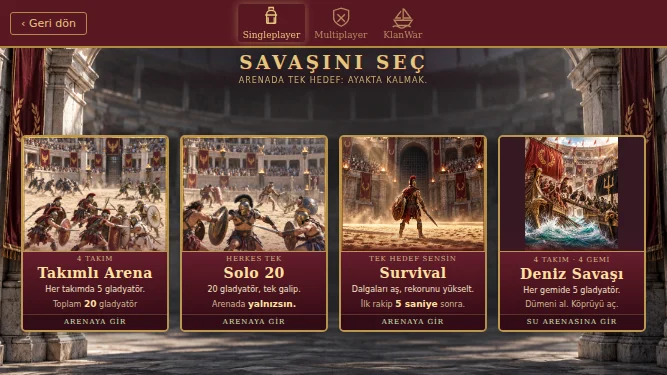
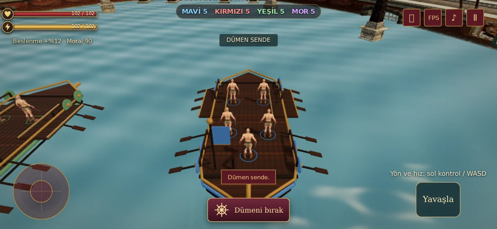
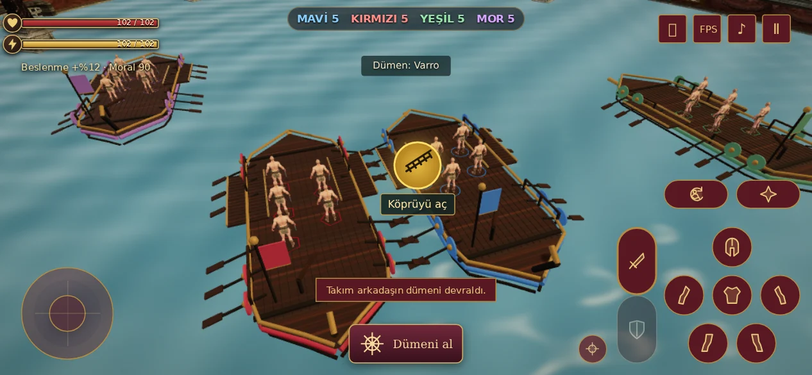
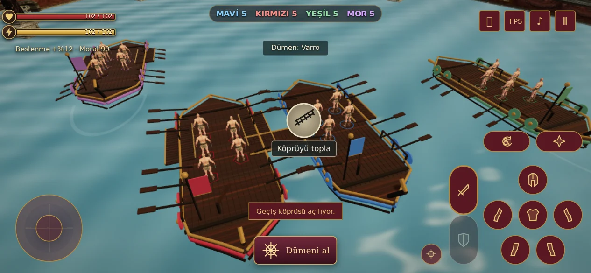

# Deniz Savaşı V97

Singleplayer menüsüne dört gemili, dört takım × beş gladyatörlü Deniz Savaşı eklendi. Oyuncu bir gladyatörü, yapay zekâ kalan 19 gladyatörü yönetir. Kolezyumun yatay boyutları ikiye katlandı: kullanılabilir savaş alanı dört katına çıktı. Kum zeminin yerini su aldı.

## Kontroller ve savaş

- Kendi gemindeyken **Dümeni al** ile kontrolü al; **Dümeni bırak** ile yaşayan ve kontrol edebilen bir takım arkadaşına devret. Klavyede **I** aynı işlemi yapar. Uygun bot kalmadıysa gemi durur.
- Dümen sende olduğunda sol hareket çubuğu veya **WASD / yön tuşları** hız ve yönü belirler. **Yavaşla** ileri/geri komutunu keser. Kamera seyir yönünü takip eder.
- Her geminin sağında ve solunda bir tahta geçiş köprüsü bulunur. Kendi bulunduğun güvertenin ilgili kenarına yaklaşınca, yalnızca köprü ucu karşı gemiye tam oturabiliyorsa **sarı köprü ikonu** görünür. Dokunarak veya **E** ile aç.
- Kontrol, köprünün iki uç köşesini ve son yarım metresini karşı güvertede arar. Gemilerin açıları, aradaki mesafe, yavaş hareket ve diğer gövdelerin yolu kapatmaması birlikte değerlendirilir. Tıklama anında koşullar yeniden kontrol edilir.
- Köprü 0,85 saniyede açılır; tam açılmadan geçilemez. Açılan köprü iki gemiyi sabitler. Üzerinde yaşayan bir gladyatör varken toplanamaz.
- Bot kaptanlar yanaşır; düşman mürettebat köprü açar, bağlantılı gemilere geçer ve mevcut yakın dövüş/ekipman sistemiyle savaşır. Son hayatta kalan takım kazanır.
- Karakterler, yerdeki ekipman ve yerleşmiş düşme pozları gemiyle birlikte taşınır. Köprü dışında suya yürünemez. Bu sürümde yüzme, gemi batırma ve gemi hasarı yoktur.

## Uygulama ve kayıt

`naval-simulation-v97.js` yalnızca deniz savaşının mevcut Combat örneğini genişletir. Kara arenasının savaş kuralları kullanılmaya devam eder. Gemi görselleri yalnızca bu modda yüklenir; ortak gövde geometrileri ve malzemeler kullanılır, kürekler birleştirilmiş çizimlerle gösterilir. Su tek bir shader yüzeyidir; ayrı yansıma sahnesi çizilmez. Köprü rota aramaları bağlantı değişene kadar önbellekte tutulur.

Bu sürüm mevcut sunucu sahipli `4x5` bileti ve `ludus_start_battle_v2` / sonuç kaydı akışını kullanır. Hesap, sahiplik, ekipman, idempotency ve ödül kuralları mevcut akıştadır; SQL migration yoktur. Deniz savaşları mevcut 4x5 ilerlemesine sayılır. `arena=naval` sahneyi seçer; aynı cihazda savaş kimliğiyle hatırlanır. Başka cihazdan parametresiz devam edildiğinde deniz görünümü geri yüklenmez; savaşın sunucudaki kaydı 4x5 olarak kalır.

Gemi modeli proje içinde kodla üretilmiş Roma esintili açık güverteli bir modeldir. Yeni GLB indirilmedi. Ahşap için mevcut `assets/textures/wooden_gate-diff-67741a5af1f9.webp`, menü için mevcut `assets/clan-water-20x2-v81.webp` kullanıldı. Kolezyum ve gladyatör kaynakları `asset-credits-v21.txt` içindedir.

## Doğrulama

- 18 deniz davranışı: takım sayısı, alan oranı, dümen devri, kaptan ölümü/sersemleme, iki köprü yönü, hatalı açı/mesafe/hız, engellenen geçiş, kilitli gemiler, açılma süresi, dolu köprü, güverte sınırları, ceset taşınması, gemi çarpışması ve botlarla maçın tamamlanması.
- Mevcut savaş/hareket/ekipman/ölüm/animasyon ve arayüz testleriyle toplam **112 kontrol**.
- Chromium'da gerçek sayfalar ve 3D varlıklar; izole hesap/RPC verisiyle menü → hazırlık → savaş bileti → deniz arenası, dümen alma/bırakma, sarı ikon, köprü açma/geçiş, geçersiz açı, duraklatma ve aynı cihazda devam etme.
- Oyun görünümü: 844×390, 667×375, 932×430, 1024×768. Menü: beş ekran boyutunda üç sekme, toplam 15 görünüm. Tarayıcı hatası yok.
- Testler üretim hesabında savaş başlatmaz veya ödül yazmaz. Chromium yazılımsal GPU kullanır. Fiziksel telefon FPS ölçümü ve Safari/WebKit doğrulaması bu sürümde yapılmadı.

```sh
node --test tests/naval-v97.test.cjs tests/adaptive-quality-v96.test.cjs tests/arena-timing-v94.test.cjs tests/movement-v39.test.cjs tests/combat-feel-v23.test.cjs tests/death-v41.test.cjs tests/bot-defense-v72.test.cjs tests/equipment-arena-v30.test.cjs tests/arena-ui-v78.test.cjs
node tests/naval-browser-v97.cjs
node tests/arena-tabs-v81.cjs
```

PGlite için `NODE_PATH`, Playwright için `CODEX_PRIMARY_RUNTIME_NODE_MODULES`, farklı bir Chromium yolu için `CHROMIUM_EXECUTABLE_PATH` ayarlanabilir. Tarayıcı çıktıları `LUDUS_TEST_OUTPUT` ile seçilir.

## Oyun içi görüntüler

İzole test hesabıyla gerçek sahne görüntüleridir.








