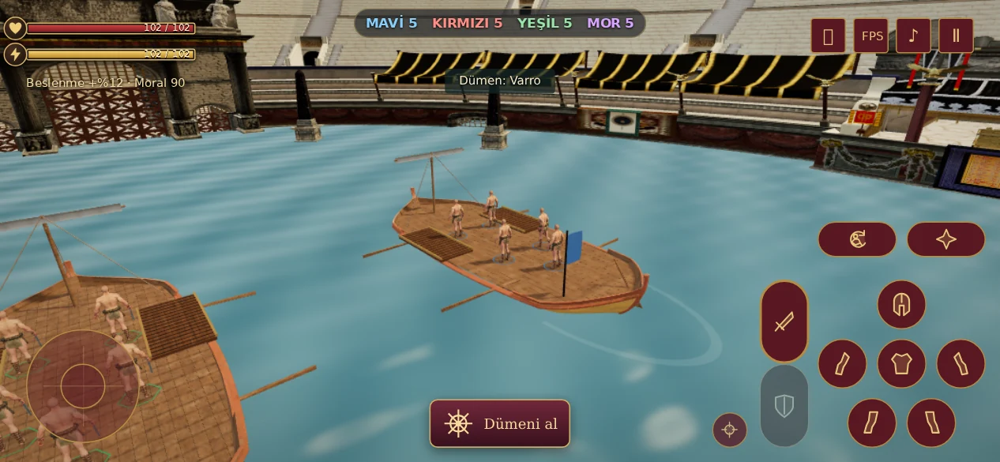
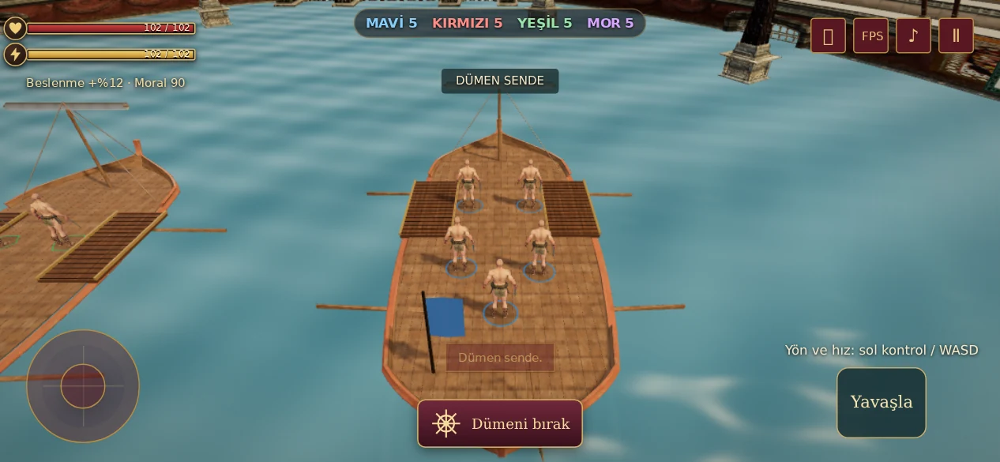
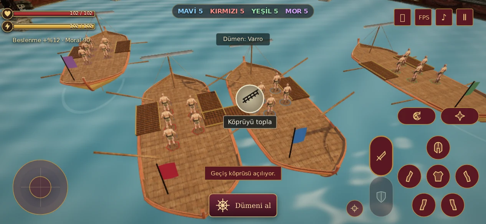

# Herculaneum teknesi V98

Önceki geometrik teknenin yerine kullanıcının yüklediği **Herculaneum Boat - Roman Boat** modeli yerleştirildi. Dört takımın her birinde beş gladyatör bulunur. Bu sürümün kapsamı tekne modeli ve yeni gövde ölçülerine uyumdur.



## Model

| Özellik | Yüklenen kaynak | Oyundaki türev |
| --- | ---: | ---: |
| Dosya | 22.618.708 bayt | 1.460.796 bayt |
| Üçgen | 66.776 | 7.064 |
| Mesh | 38 | 12 |
| Doku | 14 | 8 |
| İskelet / animasyon | Var | Yok |

Dosya %93,5, üçgen sayısı %89,4 azaldı. Karşılaştırma yüklenen GLB ile yapılmıştır; önceki prosedürel tekneye göre FPS kazanımı iddiası değildir.

Gövde yaklaşık 16,5 m uzunluğunda ve en geniş yerde 6,9 m'dir. Çarpışma zarfı 16,8 × 7 m; oynanabilir güverte 11 × 5,2 m. Kürekler çarpışma zarfına dahil değildir. Ahşap güverte gövdenin iç sınırını izler; altında koyu yüzey bulunur, plank aralıklarından su görünmez. İki yandaki sığ açıklıklar köprülerle aynı seviyededir.

Ahşap gövde, boyalı şeritler ve kaynak dokular korundu. Sıralar, gizli iç iskelet ve yoğun halat ağı çıkarıldı. Yelken toplandı, direk savaş alanının önüne alındı; dört kürek ve üç sade halat bırakıldı. Dört tekne aynı geometri, malzeme ve dokuları paylaşır; takım flaması farklı renktedir. Kürek hareketi hafif grup dönüşleri kullanır. Kaynak modelin iskeleti çalıştırılmaz.

GLB sadece Deniz Savaşı girişinde mevcut varlık yükleyicisiyle alınır. Hazırlık kutusu eklenmedi. Dümeni alıp bırakma ve AI devri, tam hizalanan sarı köprü ikonu ve köprüden geçiş mevcut akıştadır.





## Doğrulama

- 18 deniz simülasyonu testi: dört takım, AI, dümen devri, çarpışma, köprü hizası ve geçiş, savaşın tamamlanması.
- Üç varlık kontrolü: dosya/çizim bütçesi, yeni gövdenin çarpışma zarfı, gömülü lisans ve değişiklik bildirimi.
- Gerçek HTML, model ve dokularla Chromium: 667×375, 844×390, 932×430, 1024×768. Menüden giriş, dümeni al/bırak, AI devri, sarı köprü, yanlış açı, geçiş, duraklatma ve devam etme geçti; JavaScript hatası yok.
- Dört tekne için tek GLB isteği, 12 ortak geometri, 8 ortak doku, 28.256 tekne üçgeni ve sıfır skinned mesh. Güvertenin yürünebilir sınırları boyunca aşağı yönlü ışın örnekleri gerçek render yüzeyine isabet etti.
- Khronos glTF Validator: sıfır hata. Normal haritalar için 10 tangent-space uyarısı: tangent alanı motorun standart türev tabanlı shader yolunda hesaplanır. Gerçek Three.js renderı kontrol edildi.

Ham sonuç: [browser.json](browser.json), [model ölçümleri](../../assets/naval/herculaneum-v98.json). Chromium yazılımsal GPU ile çalıştı; fiziksel telefon FPS ölçümü değildir.

```sh
node --test tests/naval-v97.test.cjs tests/naval-boat-v98.test.cjs
LUDUS_TEST_OUTPUT=/tmp/naval-v98 node tests/naval-browser-v97.cjs
```

Tarayıcı testi Playwright ve `CHROMIUM_EXECUTABLE_PATH` (varsayılan `/tmp/chromium`) kullanır. Hesap/RPC fixture'ları yereldir; gerçek hesapta savaş başlatmaz.

## Kaynak ve yeniden üretim

**Opus Poly**, [Herculaneum Boat - Roman Boat](https://sketchfab.com/3d-models/herculaneum-boat-roman-boat-fd84e8e9cf184426b1701e80c9018067), [CC BY 4.0](https://creativecommons.org/licenses/by/4.0/). [Sanatçı](https://sketchfab.com/OpusPoly). Yukarıdaki model değişiklikleri projeye aittir; kaynak yazarlığı korunur. Aynı bildirim GLB içinde ve [oyun varlık kredilerinde](../../asset-credits-v21.txt) bulunur.

Kaynak GLB SHA-256: `1007cc9c4414cc03255221f66ecbff2858f4884dc821f83996022c09ce09fcf5`.

Python 3, numpy ve Pillow ile ön işlem; Node.js, `@gltf-transform/core@4.3.0`, `@gltf-transform/functions@4.3.0`, `meshoptimizer@1.3.0` ile sadeleştirme. Bunlar çevrimdışı derleme araçlarıdır, oyuna eklenmez. Paketler başka dizindeyse `NODE_PATH` kullanılabilir.

```sh
python scripts/prepare-herculaneum-v98.py source.glb /tmp/herculaneum-intermediate.glb
node scripts/simplify-herculaneum-v98.mjs /tmp/herculaneum-intermediate.glb assets/naval/herculaneum-v98.glb
```

İlk script bu kaynağın mesh/texture düzenine özeldir. Orijinal yükleme değiştirilmez ve 22,6 MB'lık kaynak oyun deposuna eklenmez.
