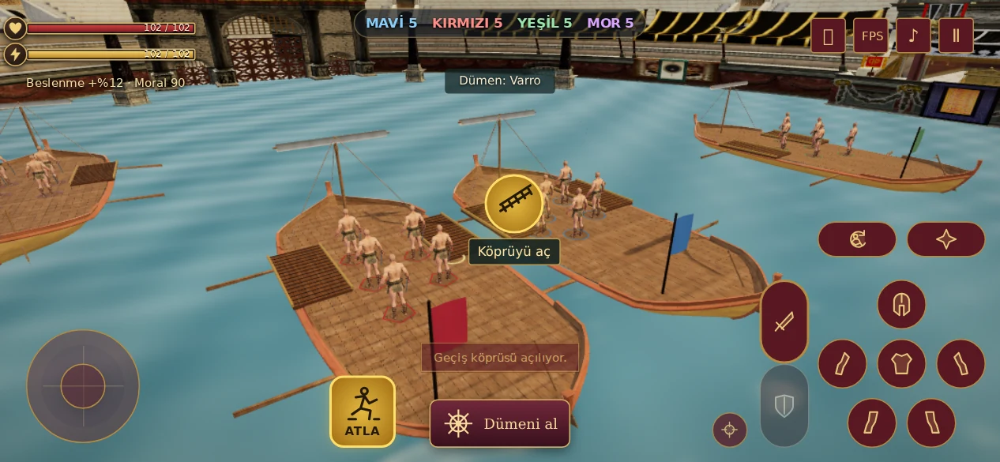
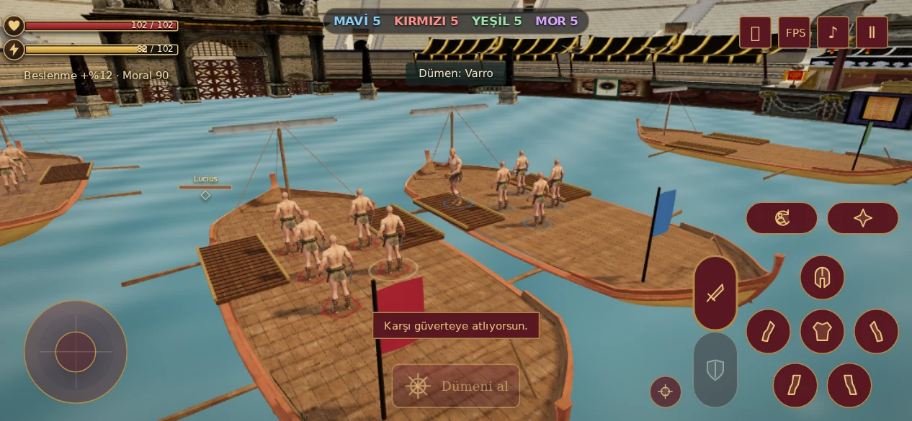

# Gemiden gemiye atlayış V99

Oyuncu, köprü açılmadan yakın karşı güverteye atlayabilir. Kenardaki geçerli konumda sarı **ATLA** düğmesi ve hedef güvertede altın iniş halkası görünür. Telefonda düğmeye, bilgisayarda **Boşluk** tuşuna basılır. Deniz Savaşı'nda **J** saldırı tuşudur; diğer arena modlarında Boşluk mevcut saldırı görevini korur.





## Davranış

- Atlayış 20 kondisyon kullanır. Başlangıç ile güvenli iniş noktası arasındaki azami mesafe 4,6 m'dir. 0,12 saniyelik hazırlık, 0,72 saniyelik uçuş ve 0,18 saniyelik iniş toparlanması vardır; uçuş yüksekliği yaklaşık 1,12 m'dir.
- Karakter gövde boyunca bir yay çizerek ilerler. İniş noktası hedef geminin yerel koordinatlarında tutulur ve hareketli/dönen güverteyle birlikte güncellenir. Gemiler atlayış nedeniyle durdurulmaz.
- Güvertenin iç tarafına iniş seçilir; dolu hedef, araya giren üçüncü gövde, uzaklaşan/çok hızlı/dönüşü keskin gemi, yetersiz kondisyon, dümen kullanımı ve uygun olmayan karakter durumu kontrol edilir. Düğmeye basıldığında hedef tekrar doğrulanır.
- Hazırlık sırasında darbe alınır veya hedef uzaklaşırsa atlayış güvenli biçimde iptal edilir ve kondisyon geri verilir. Havadaki hasar ve ölüm korunur; karakter güverteye ulaşınca doğru gemiye bağlanır.
- Uçuş sırasında yürüme, saldırı, savunma ve dümen alma devreye girmez. Darbe hedefleri görünen atlayış yüksekliğini izler; havadaki karakter zemindeki kalabalığı itmez. İnişte kısa toparlanma ve tekrar atlayış bekleme süresi vardır.
- Duraklatma uçuşu durdurur. Dokunmatik hareket çubuğu ve klavyede sağ-sol dümen yönü, arkadan takip kamerasına göre düzeltildi.

Bu sürüm oyuncunun atlayış kontrolünü ekler; AI ekipleri mevcut köprü yollarını kullanır. Herculaneum GLB ve ortak geometri/doku kullanımı değişmedi. İniş halkası tek küçük çizim ekler; yeni model veya animasyon dosyası yüklenmez.

## Doğrulama

**56 otomatik kontrol geçti:** 18 deniz simülasyonu, 3 varlık bütçesi/lisans kontrolü, 13 yeni atlayış senaryosu ve 22 dövüş/script regresyon kontrolü.

Atlayış senaryoları iki yönü, döndürülmüş ve hareketli güverteleri, menzil ve gemi hızını, dolu hedefi, üçüncü gövdeyi, kondisyonu, tekrar basmayı, hazırlık iptalini, havada hasar/ölümü ve kare süresi sınırını kapsar. Normal deniz savaşı AI köprüleri ve savaşın tamamlanmasıyla birlikte çalıştırıldı.

Gerçek sayfa, Herculaneum ve gladyatör modelleriyle Chromium kontrolü: 667×375, 844×390, 932×430 ve 1024×768. Menüden giriş, dokunmatik atlayış, Boşluk ile dönüş atlayışı, havada duraklatma, iniş, menzil dışında gizlenen ikon, çakışmayan kontrol alanları, sağ-sol dümen, AI devri, köprü açma/geçme ve oturuma devam etme geçti. JavaScript hatası yok. [Ham tarayıcı sonucu](browser.json).

Ölçülen tepe örneğinde simülasyon ve çizilen karakter kökü aynı yükseklikteydi: 1,1104 m. Ayak yüksekliği 1,3409 m; havadaki sahte zemin gölgesi gizliydi. Bu testler yazılımsal GPU'lu Chromium'da yapıldı; fiziksel telefon FPS ölçümü değildir.

```sh
node --test tests/naval-v97.test.cjs tests/naval-boat-v98.test.cjs tests/naval-jump-v99.test.cjs tests/combat-feel-v23.test.cjs
LUDUS_TEST_OUTPUT=/tmp/naval-v99 node tests/naval-browser-v97.cjs
```

Tarayıcı testi mevcut Playwright kurulumu ve `CHROMIUM_EXECUTABLE_PATH` (varsayılan `/tmp/chromium`) kullanır. Hesap ve savaş çağrıları yerel fixture'larla karşılanır. Kaynak model/lisans bilgileri [V98 belgesindedir](../naval-v98/README.md).
